# 记忆之处

## 让每一段念念不忘，都有一处可以归来

**The Pensieve · 项目报告**  
叙事、交互与生成式三维探索｜基于 `v0.6.0-daylight-detail`｜2026 年 10 月 28 日

> 记忆让我们每个人与众不同，也给予我们感动与力量。

一张照片里，可能有一件舍不得丢掉的旧物、一间曾经住过的屋子，或一段已经很久没有提起的生活。画面留住了那一刻的样子；当我们再次看见它，人与物、人与地方、过去与此刻之间的联系，也有机会重新浮现。

**《记忆之处》是一件以私人记忆为内容、以空间和仪式为表达的交互作品。** 它把照片转化为可收藏、可归类、可再次相遇的数字记忆：先将一缕记忆交给冥想盆，再把它安放到属于自己的记忆大厅，最后，等待一只燕子偶然把它送回来。

作品由三个正式体验章节和一条独立的技术实验线组成。三个章节分别回应三个愿望：**愿意珍藏、能够寻回、再次被触动。** AHOLO World 实验则记录了为了让这些愿望拥有可信的三维载体，项目如何试探能力、识别问题，并逐步修正。

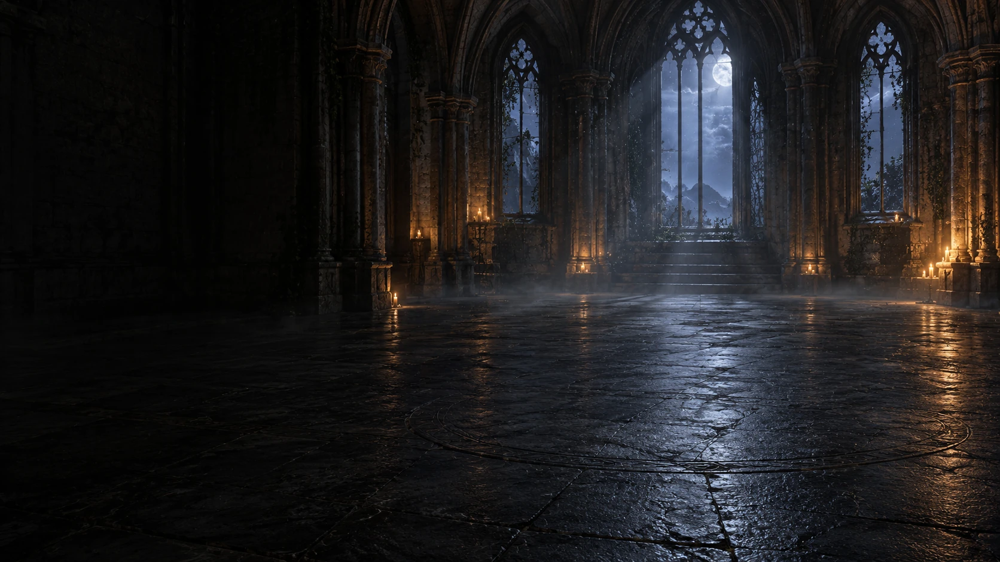

*封面图：第一章使用的 AI 生成氛围底图。水面、银丝、烛光等交互效果由程序另行渲染；本图不是 AHOLO 空间重建结果。*

## 一、创意从哪里来：为记忆设计一个值得再次打开的地方

项目的起点，是对“收藏”这一动作的重新想象。文件夹能容纳很多照片，而作品希望进一步提供一个有情绪、有空间感的入口，让人愿意认真放下一段记忆，也愿意在日后回来看看。

因此，设计首先确定了三个意象。

**水，承接记忆。** 第一章借用《哈利·波特》中邓布利多的冥想盆意象：记忆化作银丝，落入水面；触碰水面，仿佛重新走近那一刻。选择照片之后的停顿、注入、涟漪和潜入，共同构成一个可感知的交付过程。

**水晶，安放记忆。** 第二章把地点与记忆集合对应起来。家、工作室、旅途中、花园、故乡，都可以成为一颗独特的水晶。人们走过的地方逐渐汇聚，形成个人的记忆宫殿。

**燕子，送回记忆。** 第三章的灵感来自许嵩《半城烟沙》中的归燕与二月花。信使衔着花与盲盒飞来，替人捎回一份曾经珍藏、后来暂时搁置的念想。这里的重逢由偶然开启，意义由打开它的人赋予。

这些意象都对应真实的操作。银丝对应输入，水晶对应归类与访问，盲盒对应随机回看。作品的情绪表达由这些动作逐步建立，技术功能也因此拥有了清楚的叙事位置。

## 二、作品结构：三个章节，一条探索线

| 部分 | 体验主题 | 用户做什么 | 记忆发生什么变化 |
| --- | --- | --- | --- |
| 第一章：缘起 · 记忆冥想盆 | 珍藏 | 选择照片、注入、潜入、主动选择生成 | 从照片成为可查看的原片、立体物件或空间资产 |
| 第二章：汇聚 · 记忆大厅 | 归属 | 为记忆标记地点，轻触水晶打开集合 | 从一条记录成为个人记忆宫殿的一部分 |
| 第三章：重逢 · Aha moment | 唤回 | 等候归燕，打开记忆盲盒 | 从已经收藏的记录，成为此刻的一次重逢 |
| ＋1：AHOLO 世界实验 | 探索 | 对照输入、实际模型、不同位置与近景 | 从视觉设想走向可检验的三维表达 |

贯穿三个章节的是同一条记忆生命周期：

**照片 → 注入与初次回看 → 用户确认生成 → 数字资产 → 地点归类 → 主动寻回或随机重逢。**

“3＋1”的结构，也为作品保留了清晰的边界。正式体验服务于人的回忆，实验区服务于能力探索；试验中的大厅、失败模型和生成样品，不会自动混入个人的记忆盲盒。

## 三、第一章：缘起 · 记忆冥想盆

### 3.1 从“选择一张照片”到“交出一缕记忆”

第一章从一个简单的动作开始：选择照片。随后，魔杖银丝注入水面，水池泛起涟漪，记忆完成交付。用户再触碰水面，镜头潜入，首先看见原照片。

这个顺序很重要。原照片承担着记忆最初的凭据；后续的三维生成，则为这段记忆增加一种新的观看方式。即使生成结果存在补全、模糊或细节偏差，用户仍然可以回到原片，确认自己当初珍藏的内容。

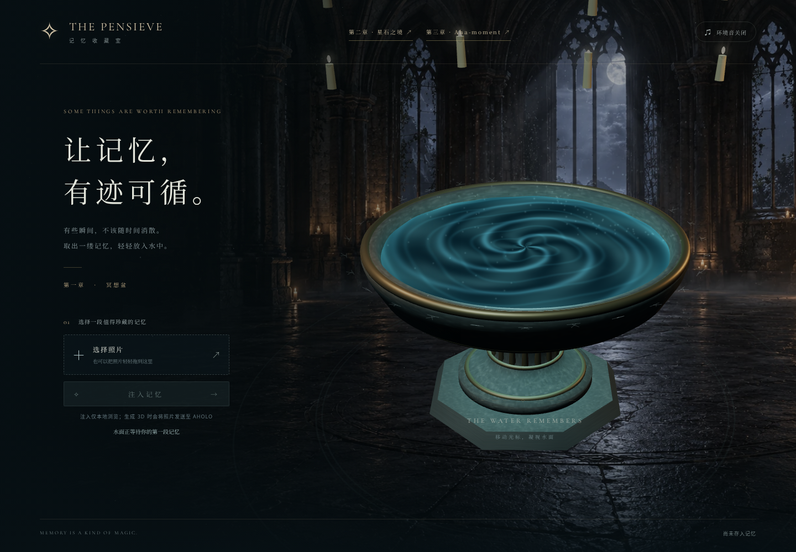

*图 1：冥想盆界面。截图使用空记忆库，不包含私人照片；画面展示的是照片输入之前的真实界面状态。*

### 3.2 两条生成路线，对应两种回看的尺度

用户可以主动选择生成类型：

- **物件记忆：** 将照片中的主体交给 AHOLO Lux3D，得到 GLB 模型，可旋转、缩放，观察不同方向的外形。背景简单、主体清楚的静物更适合这条路线。
- **空间记忆：** 将照片交给 AHOLO World，获得三维高斯场景资源，进入空间查看器环顾，并进行有限的位置移动。单图看不到的区域由模型补全。

生成完成后，原片与数字资产共同构成一条记忆记录，用户还可以为它标记一个或多个地点。这样，一件物品既能留在冥想盆中，也能出现在第二章相应的水晶集合里。

### 3.3 仪式与生成，各有自己的时机

注入仪式在本地完成。选择照片、观看银丝和涟漪、打开原片，都不会自动提交生成任务。只有用户主动确认生成时，当前照片才会上传。

后台保存任务编号，持续查询已有任务，并把完成的模型缓存在本机。用户可以离开页面，稍后再回来查看；重复打开一段记忆，也不会因此重新生成。这个安排让“愿意珍藏”可以先发生，让等待与成本留在明确的确认动作之后。

## 四、第二章：汇聚 · 记忆大厅

### 4.1 让走过的地方，成为记忆的坐标

我们一生会走过很多地方，遇见很多人。同一处地方，常常连接着不同时间的片段；同一段记忆，也可能同时属于家、旅行与某个人生阶段。

第二章把这种联系转化为一组可以看见、触碰和编辑的水晶。默认地点包括家、工作室、旅途中、花园、故乡。用户可以调整地点名称、颜色，也可以增加新的地点，当前最多支持十二处。

每一颗水晶代表一个记忆集合。轻触晶石、空间标签或底部地点按钮，就能打开对应的原片、立体物件或空间记忆。新增或移除某个地点的归属，会保留这段记忆在其他地点中的关联。

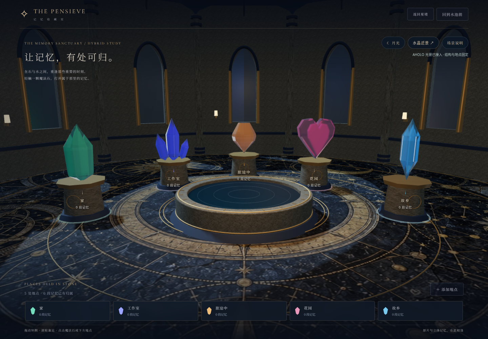

*图 2：记忆大厅。截图使用系统默认地点与空记忆库；水晶可以作为真实三维点击目标，打开对应集合。*

### 4.2 从散落星石到记忆宫殿

第二章保留了两种空间表达。早期的“星石之境”以悬浮岛与彩色晶石组织地点；后续“记忆大厅”把地点带入由石墙、拱窗、穹顶和水池围合的室内空间。两者共用地点与记忆关联，体现了同一套记忆组织方式在不同场景中的延伸。

正式记忆大厅采用程序构建的 Mesh，固定墙体、水池与水晶的结构，再复用已有 AHOLO 全景作为环境照明与窗外光景。五个默认地点还对应不同的程序水晶轮廓：长晶、晶簇、切钻、心晶与双尖。颜色之外，形状也成为辨认地点的线索。

这些程序水晶与后续生成的五颗 Lux3D 样品分开展示。当前大厅没有把试验中的 API 样品直接替换为正式地点资产，也没有将全景环境光描述成可自由行走的三维重建。

### 4.3 把归属权留给用户

一张照片可以先归档、先分类，之后再决定是否生成模型。没有立体资产的原片，也能够成为记忆宫殿的一部分。

分类由用户亲自选择。当前作品没有自动判断照片属于哪个地点，也没有自动推断它的情感含义。地点名称和关联方式，保留着个人对这段经历的理解。

## 五、第三章：重逢 · Aha moment

### 5.1 为你衔来二月的花

前两个章节里，用户主动选择、整理和寻找。第三章把开场交给一只燕子。

暮色的窗前，燕子衔着花与盲盒飞来。盒中是一段已经成功生成、保存在个人记忆池里的内容。它可能是一件旧物，也可能是一处空间。打开之后，作品先展示立体记忆，再让用户自行切换到原照片。

这使重逢拥有一个短暂的悬念：今天，哪一段时光会来到面前？

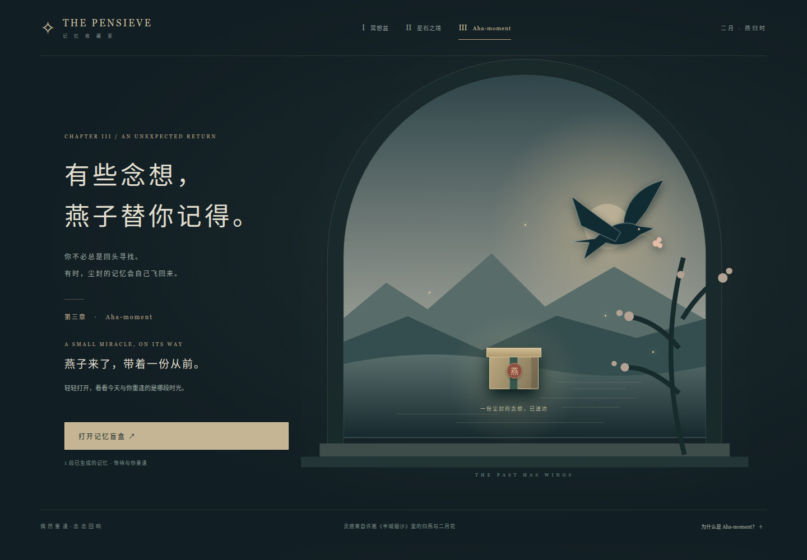

*图 3：第三章交互示意。截图使用隔离的演示记忆，只展示归燕送达与盲盒入口；真实运行只抽取个人已生成的记忆，实验资产不会自动进入记忆池。*

### 5.2 一次偶然，重新接上过去与现在

“Aha moment”借用了忽然领悟、重新理解的意象。DeepSeek-R1 的技术报告曾以这个词描述 R1-Zero 训练中出现的重新审视解题思路的行为。作品把这种“重新看见”的感觉，转译为一次与旧日内容的相遇。[研究背景见 DeepSeek-R1 报告第 2.2.4 节](https://arxiv.org/html/2501.12948v1)。

这是一种创意上的借用。本项目没有训练语言模型，也没有让模型替用户判断“此刻最需要哪段回忆”。信使负责送回内容，用户在观看时形成自己的感受与理解。

### 5.3 让偶然拥有可靠的规则

盲盒只从已完成、具有可用立体资源的个人记录中抽取。失败或未完成任务、仅归档的原片，以及独立实验结果，都不在抽取范围内。

当前页面会先打乱记忆池，再逐条抽取；一轮结束后重新洗牌。当池中有多条记忆时，相邻两次不会抽到同一条。抽取进度保留在当前页面会话中。

燕子送达、拆盒、关闭来信、查看原片与立体结果，都只读取已有资源，不增加生成任务。空记忆池、连接失败、单条记忆、键盘退出和减少动态效果，也都有对应处理。情绪上的轻盈，需要这些不打扰人的细节来支撑。

## 六、重要资产：氛围、形体与证据怎样一起形成

项目中的“生成”有不同的来源与用途。它们共同构成体验，也需要被清楚区分。

| 资产 | 来源与格式 | 在作品中的作用 | 需要说明的边界 |
| --- | --- | --- | --- |
| 冥想盆室内氛围底图 | AI 图像生成，WebP，1672×941 | 建立烛光、石盆与记忆收藏室的气氛 | 是静态图像；动态水面与银丝由 Three.js 渲染 |
| 个人物件记忆 | AHOLO Lux3D，GLB | 将照片主体变为可旋转的数字物件 | 单图不可见部分会被补全，原片始终保留 |
| 个人空间记忆 | AHOLO World，SPZ／PLY，部分结果附全景 | 环顾空间，尝试有限的位置移动 | 不能当作真实测绘，也没有完整墙体碰撞 |
| 五颗魔法水晶样品 | AHOLO Lux3D G1 文生 3D，GLB | 探索长晶、晶簇、切钻、心晶与双尖造型 | API 原材质与浏览器通透展示材质分开展示 |
| 月光、日光大厅参考图 | AI 图像生成，JPEG／WebP | 为 World generation 提供视觉输入 | 输入概念图不等于平台生成的三维输出 |
| 唯一地面图案与浅色石灰岩纹理 | AI 图像生成，WebP | 提供材质细节与可区分的匹配特征 | 颜色图中的纹理不等于真实雕刻几何 |
| 第五组稳定大厅 | AHOLO World reconstruction，SPZ | 验证完整空间与五颗水晶能否稳定重建 | 结构初检通过，细节不足另行处理 |
| 第六组日光细节大厅 | 原生精细 Mesh ＋独立 World 重建结果 | 对照精确几何与云端重建保留的细节 | 两种结果分开标注，近景精度与折射能力不同 |

### 6.1 五颗真实生成的水晶

五种样品均通过 Lux3D G1 文生 3D 返回，并保留了各自的请求与提示词。

| 样品 | 请求面数 | 返回模型实际三角面 |
| --- | ---: | ---: |
| 翡翠长晶 | 50,000 | 49,516 |
| 紫晶簇 | 20,000 | 19,174 |
| 琥珀切钻 | 20,000 | 19,167 |
| 蔷薇心晶 | 20,000 | 19,682 |
| 冰蓝双尖 | 20,000 | 19,998 |

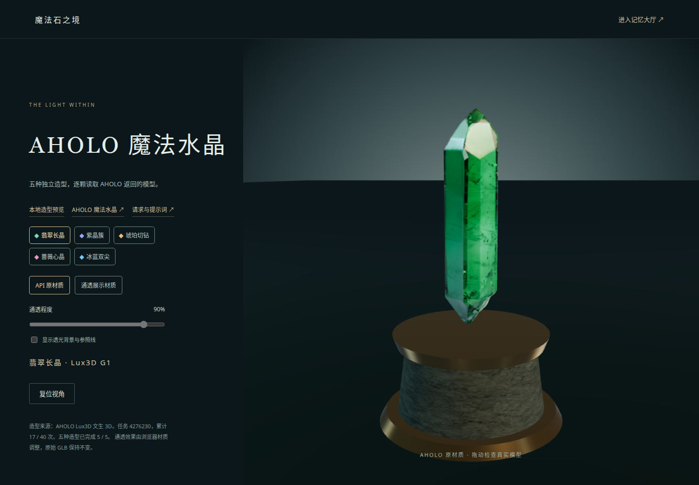

*图 4：翡翠长晶实模，展示 API 原材质。截图来自五颗样品的生成阶段；通透展示材质是浏览器侧的显示调整，不改写原始 GLB。*

生成已经带来了不同的轮廓，但样品评审仍发现一些具体问题：紫晶簇底部出现了额外碎晶，部分模型带有烘焙在贴图里的反光，个别形体或纹理仍需打磨。作品保留这些结果，使读者能够同时理解模型的能力与后续美术工作的必要性。

### 6.2 资产保存，也是体验设计的一部分

模型完成后保存在本机，查看器读取缓存，降低对短期下载链接的依赖。个人照片、私人模型、地点标签和密钥不进入公开的实验资源目录。

已经发布到仓库的六组非私人 World 实验，则包含 202 张输入图、六份 SPZ、两张全景及部分检查证据。这样，另一台机器拉取仓库后也能查看试验，无需重新生成，更不需要覆盖它自己的个人记忆与额度状态。

## 七、AHOLO 世界实验：从一间漂亮的大厅，到一处可信的空间

### 7.1 六组实验，回答了不同的问题

| 组别 | 方法与输入 | 实际观察 | 得到的认识 |
| --- | --- | --- | --- |
| 01 · 月光大厅 | 单张概念图生成空间 | 氛围成立，细节偏柔，背面补出走廊，水晶位置变化 | 单图生成可以建立世界感，物件一致性还需检查 |
| 02 · 首次图重建 | 固定三维大厅的 24 个相机视角 | 严重拉伸、漂浮色块，无法辨认完整大厅 | 图片数量达标与接口完成，都不足以证明重建可用 |
| 03 · 修正重试 | 24 张新视角，修正地面纹理、部分反光与镜头信息 | 局部匹配改善，整体仍残缺、塌缩 | 需要检查所有连接，不能只看平均表现 |
| 04 · 日光大厅 | 新的日光低反光单图生成 | 正面较清楚，出现额外白色近景水晶及底座，背面也补出水晶 | 画面漂亮与数量、位置可信，需要分别验收 |
| 05 · 稳定结构 | 72 个密集视角，高质量重建 | 已检查位置的大厅完整，五色水晶与水池稳定成形 | 改善输入与匹配后，重建获得了可靠的结构基础 |
| 06 · 日光细节 | 新精细场景的 80 个视角，高质量重建 | 新增底座、池沿雕纹可辨，极近处微纹理仍软化 | 细节需要先存在于输入，也需要单独检查输出是否保留 |

这些图重建输入来自同一个固定三维场景的不同相机位置。每一帧中的几何、物件和灯光保持一致，并非为每个角度分别生成一张可能互相矛盾的幻想图。

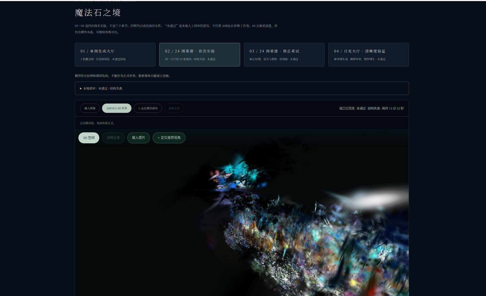

*图 5：第二组实际重建画面，出现明显拉伸与漂浮碎片。保留失败结果，是为了让后续修正有可追溯的起点。*

### 7.2 日光大厅为什么还不能直接交付

第四组让大厅第一次显得明亮、清楚。输入图中有绿、紫、金、粉、蓝五颗水晶，而返回结果的一个视角里，多出了一颗很大的白色水晶及底座。侧移与背面检查进一步暴露了物件一致性问题。

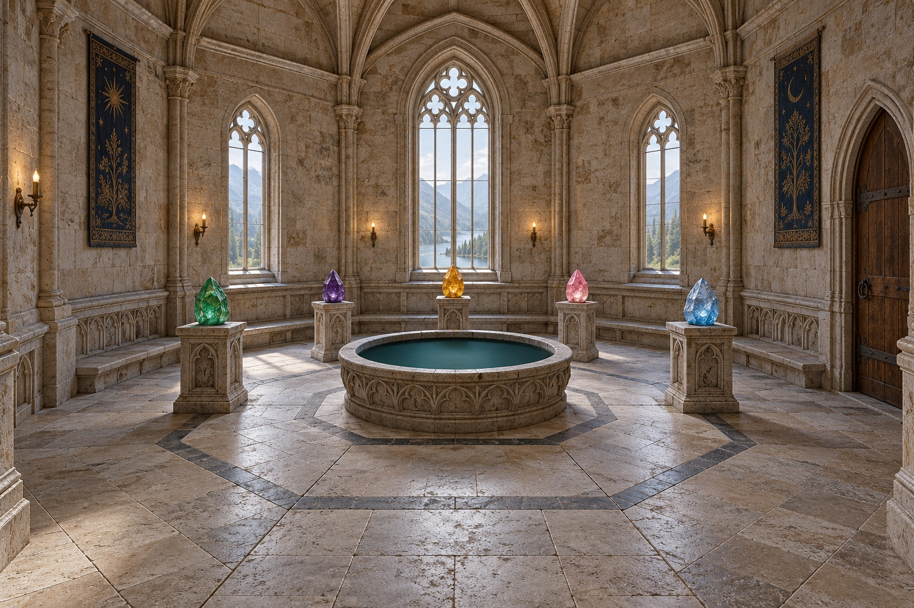

*图 6：第四组输入概念图，五颗彩色水晶。它是图像生成素材，不是 AHOLO 输出。*

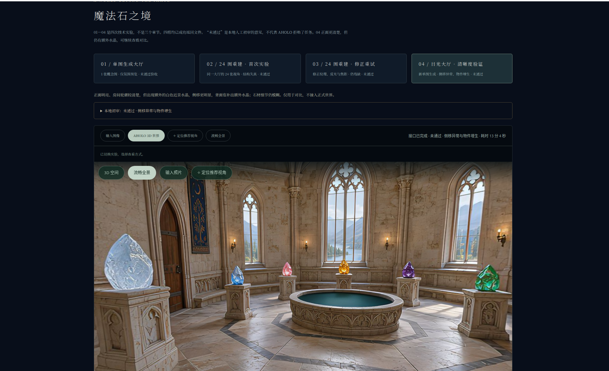

*图 7：第四组返回的全景视角。左侧新增的白色水晶及底座，在输入图中并不存在。全景可环顾，不能用这一张画面证明位置移动后的三维结构正确。*

这一步带来的判断是：**房间需要成立，记忆的坐标也需要稳定。** 一颗水晶未来承载着一组具体记忆，它的数量、位置与身份，应当能够被清楚辨认。

### 7.3 第五组：先把相机之间的联系接稳

重新检查旧修正版的全部相邻视角后，发现其中一对的恢复旋转误差约 19.25°，平移方向误差约 157.87°。多数连接尚可的中位数，掩盖了局部严重错误。

第五组据此同时修正了四处：

1. **加密视角。** 从 24 张增加到 72 张，角度间隔从 15° 缩小到 5°，最大相邻位移降至约 0.65 米。
2. **区分墙面。** 为不同墙面加入独特、固定的裂纹和色斑，减少相似墙体、柱子之间的错误对应。
3. **消除镜面项。** 水面、水晶和金属采用漫反射材质，降低随视角变化的高光对匹配的干扰。
4. **提高重建档位并保留镜头信息。** 使用 `high`、室内空间配置，保存与虚拟相机一致的焦距元数据和精确像素内参。

| 本地输入几何检查 | 03 · 24 视角修正版 | 05 · 72 视角结构版 | 06 · 80 视角细节版 |
| --- | ---: | ---: | ---: |
| 未达本轮门槛的相邻图 | 8 / 24 对 | 0 / 72 对 | 0 / 80 对 |
| 最差恢复旋转误差 | 19.25° | 0.3821° | 0.3652° |
| 旋转闭环漂移 | 30.7174° | 0.8937° | 0.9239° |

这些测量使用已知虚拟相机内参与位姿真值，对相邻图恢复结果进行比较，并检查首尾旋转闭环。它们不是完整 SfM 或尺度闭环验证，也不能证明云端内部采用了同一个解。各轮同时改变了多项条件，因此不把全部提升归因于单个参数。

只有通过预检、且图片与相机文件指纹相符的输入集，才允许进入新一轮提交。随后仍要打开真实输出，检查正面、左右侧移、前移和背面。

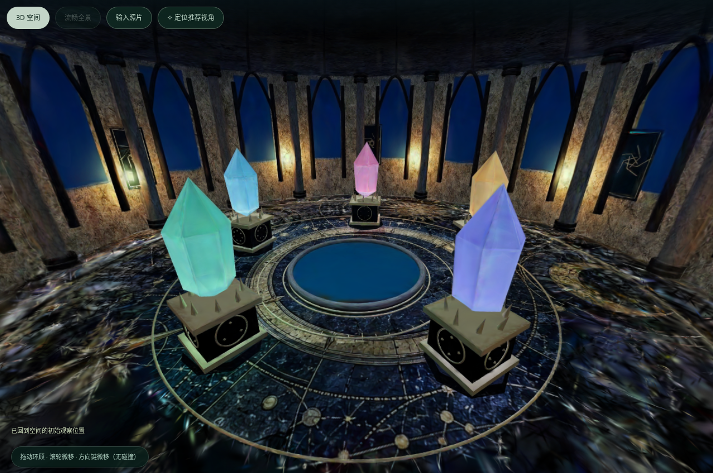

*图 8：第五组真实 3DGS 总览。所查视角内，大厅、水池与五颗水晶稳定成形；此时细节仍未优化到位。*

### 7.4 用户的一句反馈，重新定义了“做完”

结构改善之后，仍收到一个直接的反馈：

> “为什么只能看到两个水晶，不是全部？细节也没有优化。”

这句话指出了两层尚未完成的工作。

首先，入口脚本版本与旧相机预设可能被保留，用户仍停在水池中央；固定的竖直视场也无法保证窄屏拥有相同的横向覆盖。即使模型里有五颗水晶，打开时看不见，也没有完成体验上的交付。项目因此更新入口与预设版本，按窗口比例调整总览取景，并加入可复位的清楚观察位置。

其次，预览像素预算与输入本身的简化细节，是两个不同的问题。清晰模式可以减轻显示模糊，静止时最高使用约四百万像素预算，拖动时降低负担；但一个简单底座，在提高分辨率后依然是简单底座。缺失的雕纹，需要从输入几何重新制作。

### 7.5 第六组：把细节做进场景，再检查它是否留下来

日光细节版重新制作了五个多层倒角石座，在四面加入尖拱、叶形与中心纹饰；水池采用中空旋转体，池壁和池口分离，并加入二十八组重复雕纹。窗框、窗梃、柱头、拱顶肋骨、地砖接缝和木门五金也具有实际几何。

新石材颜色图提供微观纹理，程序几何提供雕刻的轮廓、厚度与遮挡。水晶则增加封闭切面、微裂纹与透明展示材质，并检查法线朝向和底座接触，避免悬空与错误光照。

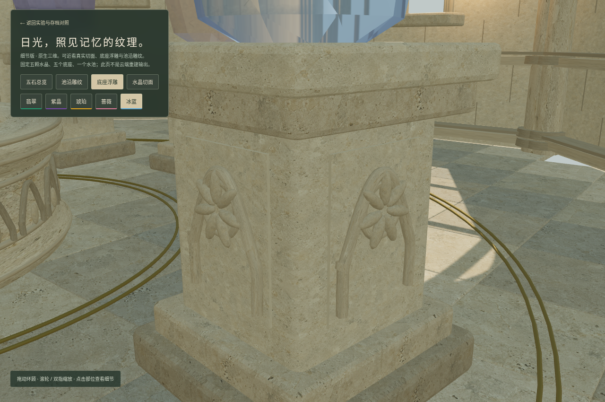

*图 9：原生三维的底座近景。浮雕是实际几何，可以从不同角度观察。*

这套场景进一步采集了 80 个 1600×1000 视角，提交一次高质量重建。为了稳定校准，采集图中暂时关闭水晶折射；原生交互页仍保留透明材质。因此，云端结果不被描述为拥有原生材质的真实可变折射。

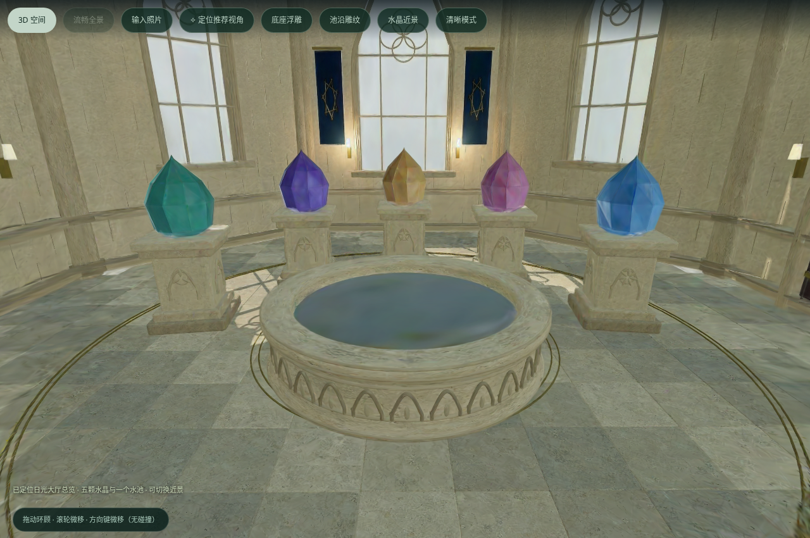

*图 10：第六组真实 3DGS。总览同时可见五颗水晶与水池，底座和池沿雕纹已经能够辨认。*

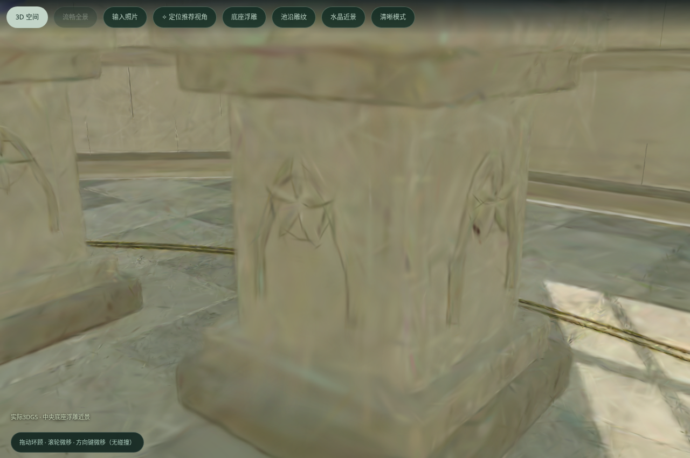

*图 11：同一云端结果的底座近景。较大的纹样得到保留，极近处石材颗粒仍有软化。与图 9 的原生几何分开呈现，便于判断差异。*

第五组实际解析得到 519,881 个高斯核，第六组为 468,827 个。第六组新增雕纹依然能够被辨认，这次观察也提醒我们：资产统计应与视觉验收一起阅读，不能单用核数代替质量判断。

## 八、怎样让情绪体验可靠运行

技术实现围绕三个层次展开：前端负责仪式、空间和查看；本地服务负责记忆、任务与状态；AHOLO 负责外部资产生成。

| 层次 | 承担的工作 |
| --- | --- |
| 前端交互与三维 | Three.js 渲染水面、银丝、Mesh 大厅与 GLB；Aholo Viewer 加载实际 3DGS；处理地点面板、盲盒、相机与原片切换 |
| 本地 Python 服务 | 照片处理、任务去重、额度预留、后台查询、资源下载、本地归档、地点关联与个人／实验记录隔离 |
| 外部生成能力 | Asset 上传、Lux3D 物件与水晶生成、World 单图空间生成和多视角重建 |
| 版本与证据 | Git 提交、存档标签、公开实验输入、模型、截图与质量记录，使结果可回看、可复现 |

### 8.1 等待可以恢复，查看可以重复

同一输入按模式与内容哈希复用任务。已经取得任务编号后，恢复操作只查询原任务；提交回执不明确时，不自动重新创建。失败、暂停、缓存完成与可查看状态，也分别保留，避免把技术等待变成用户反复付费的操作。

截至本报告所依据的版本，本地累计预留为 **19 / 40 次**。它是保守记录的提交尝试数量，包含被拒绝或结果不确定的尝试，不等同于成功资产数量或平台实际账单。本报告制作与浏览截图没有新增 AHOLO 生成。

### 8.2 静止时安静，移动时适应设备

场景在相机、尺寸或内容变化时按需绘制。移动时降低像素负担，停止后恢复；隐藏页面或退出查看器时暂停、释放资源。细节大厅把静态石材按材质合并，代表性观察中的绘制批次从约 1,567 降至 39，雕刻几何仍被保留。

原生版与重建版都提供总览和局部入口。手机不只是缩小桌面画面：五颗水晶需要完整入镜，单颗近景也需要避开顶部控制区。这些改动直接回应了“打开后究竟能看见什么”。

### 8.3 每种视觉结果，都标明它来自哪里

报告和界面区分三类结果：

- **原生 Mesh：** 结构、物件数量与材质由程序明确构建。
- **单图生成的空间：** 由模型补全不可见区域，可能偏离输入。
- **多视角重建的 3DGS：** 由多张一致视角重建，仍需检查结构与细节。

正式记忆大厅采用 Mesh 与已有全景光景；日光原生细节页采用精细 Mesh 与材质；World 结果由独立查看器展示。本版没有将它们描述为已经完成的同帧云端混合渲染产品。

## 九、当前成果与尚待继续的部分

目前，作品已经形成可运行的三章体验：从照片输入与原片查看，到物件／空间生成、地点归类，再到历史立体记忆的随机重逢。配套实验保留了六组 World 结果与五种 Lux3D 水晶样品，使创意、资产、失败和修正能够互相对应。

验证覆盖了三十项后端检查，以及实际浏览器中的查看器复用、相机复位、地点关联保留、盲盒抽取规则、键盘退出、手机布局、物件数量、朝外法线与底座接触。这些检查说明已实现流程的状态；它们不替代真实用户的长期体验研究，也不构成所有设备流畅度的承诺。

作品仍有几个明确的边界。单图补全无法保证记忆事实的完全保真；实际 3DGS 近景微纹理依然柔化；浏览器折射是实时近似；空间移动尚无完整碰撞与路径导航。当前也没有自动语义分类、情绪推荐、多用户账号或个人记忆的跨机器云备份。

后续可以沿着三条与作品愿望一致的路线继续：为真实物件和地点提供更稳定的多角度采集；让用户为记忆补上一句自己的说明、时间和意义；通过真实体验研究，观察怎样的回看频率、等待长度和交互强度，能让人感到自在，愿意回来。

“被触动”最终需要由体验它的人来回答。作品现在提供的是一条可以亲自走过的路径，以及能够继续被检验的创作基础。

## 十、让记忆，继续参与今天

冥想盆让人郑重地收藏一刻，记忆大厅让纷杂的经历获得归属，燕子则给旧日内容一个偶然回到面前的机会。三个章节由同一个愿望连接：让那些构成我们的经历，能够被再次看见。

从创作到调试，项目也经历了相似的过程：先产生一个令人向往的画面，再寻找能承接它的结构，然后通过一次次真实观看，分清已经做到的事情与还需要努力的地方。

当燕子衔着花飞来，打开的是一段影像，也是当时那个仍被我们记得的自己。

**记忆让我们每个人与众不同，也给予我们感动与力量。《记忆之处》愿意为这样的力量，留一盏灯、一池水，和一处可以归来的地方。**

## 附录 A：体验与展示入口

| 内容 | 本地路径 | 展示重点 |
| --- | --- | --- |
| 第一章 | `/` | 选择照片、注入仪式、原片与立体资产 |
| 第二章 · 星石之境 | `/atlas/` | 地点组织与原型演进 |
| 第二章 · 记忆大厅 | `/atlas/hybrid/` | 点击水晶，查看对应地点记忆 |
| 第三章 | `/aha/` | 归燕、盲盒、先立体后原片的重逢 |
| 真实水晶样品 | `/atlas/crystal-lab/?source=aholo` | API 原材质、展示材质与五种造型 |
| 原生日光细节版 | `/atlas/detail/` | 五石总览、水晶、底座与池沿近景 |
| World 实验 | `/atlas/lab/` | 原始输入、实际输出、失败与修正对照 |

运行服务后，以 `http://localhost:4174` 为前缀访问。查看缓存资产不需要重新生成；创建新任务需要在服务端提供密钥。

展示时建议先用已有记忆走完“珍藏—汇聚—重逢”，再进入实验区解释技术过程。首次启动且没有个人记忆时，第三章显示空状态与收藏引导；不会自动将实验大厅当作私人回忆。报告第三章配图使用隔离演示数据，不改变真实记忆库。

## 附录 B：存档与事实依据

| 存档 | 提交 | 内容 |
| --- | --- | --- |
| `v0.5.0-aha-structure` | `29046d3` | 第三章、第五组稳定结构、五石总览与清晰模式 |
| `v0.6.0-daylight-detail` | `fe1ebaf` | 原生细节大厅、第六组实际重建与近景入口 |

版本、公开实验输入和实际输出已同步到 [项目 GitHub 仓库](https://github.com/yangrudan/pensieve)。本报告以 v0.6.0 的实现和记录为基线，不把设想中的后续能力写成已完成功能。

主要项目证据：

- [运行、正式章节与数据流程](../../README.md)
- [早期个人记忆生成探索](../../AHOLO_EXPLORATION.md)
- [记忆大厅的结构、光景与交互边界](../../HYBRID_HALL.md)
- [五颗真实 Lux3D 水晶样品与材质记录](../../CRYSTAL_API_TRIAL.md)
- [六组 World 实验与局部几何检查](../../WORLD_EXPERIMENTS.md)
- [日光细节版实现、输出与验证](../../DAYLIGHT_DETAIL.md)
- [可跨机器读取的非私人实验资源](../../shared/world-lab/README.md)
- [Aha moment 的研究意象来源：DeepSeek-R1 v1，第 2.2.4 节](https://arxiv.org/html/2501.12948v1)

*创意意象分别致意《哈利·波特》中的冥想盆与许嵩《半城烟沙》中的归燕、二月花。作品界面与部分技术命名沿用 The Pensieve；本报告以“记忆之处”组织整体叙事。除明确标注的界面演示数据外，实验数字与资产描述均依据项目记录，未包含私人记忆照片。*
